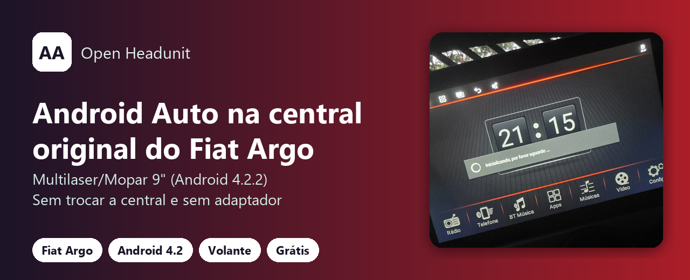
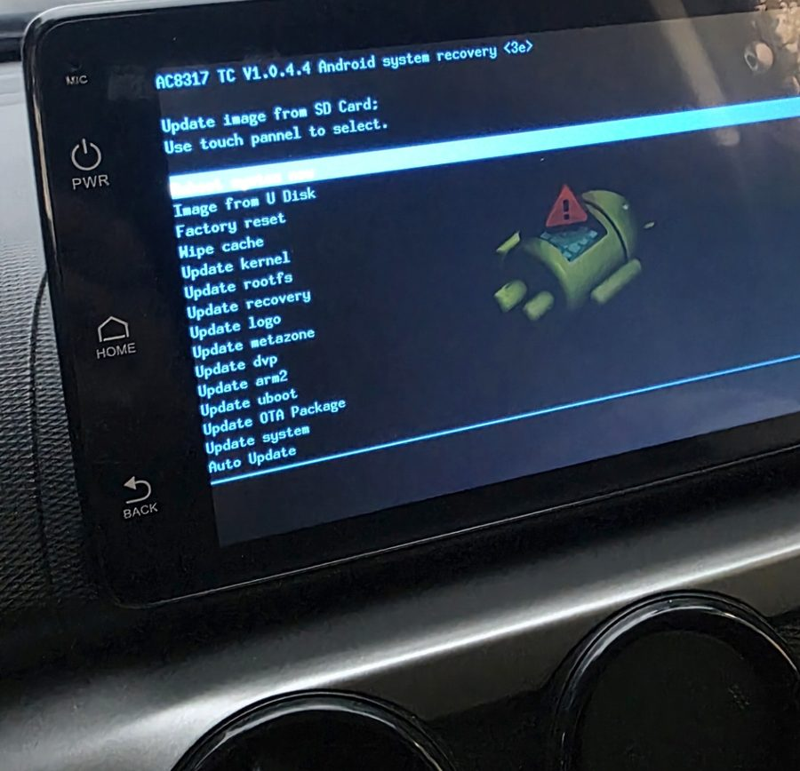
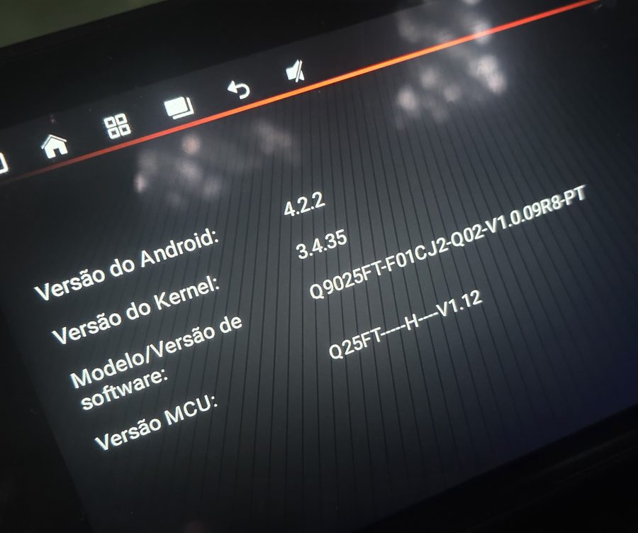
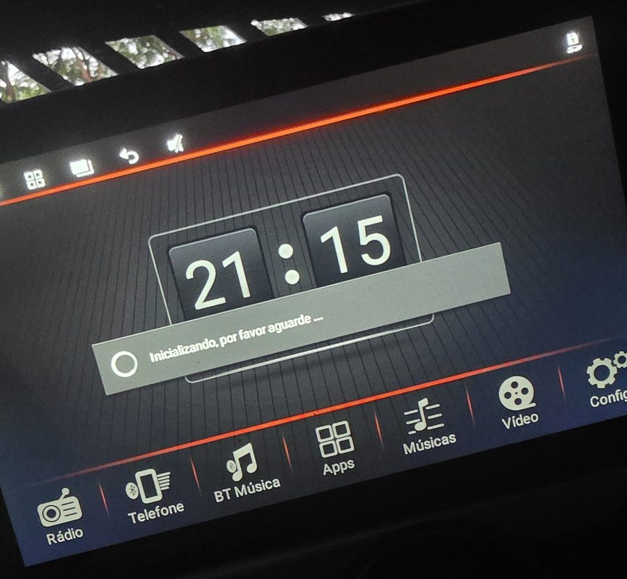
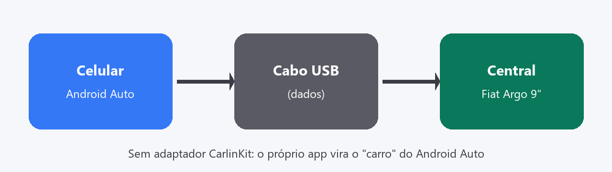

# Android Auto na central original do Fiat Argo 9"



**Use o Android Auto do seu celular na central de fábrica do Fiat Argo** (Multilaser/Mopar 9"), sem trocar a
central e sem comprar adaptador. É só instalar um app na central e ligar o celular no cabo USB.

> ⚠️ **Versão beta.** Os APKs foram montados e conferidos, mas o teste completo no carro ainda está em
> andamento. Use por sua conta e risco e conte nos [Issues](../../issues) como foi no seu carro.

- ✅ **Grátis e de código aberto** (baseado no [Open Headunit](https://github.com/andreknieriem/open-headunit), GPLv3)
- ✅ **Roda no Android 4.2.2** da central (o app funciona a partir do Android 4.1)
- ✅ **Instala como app normal**: não mexe no sistema da central
- ✅ **Funciona com o carro andando** (não depende do freio de mão)
- ✅ **Botões do volante** (próxima, anterior, avançar e voltar)
- ✅ **Imagem em 720p** ajustada para a tela de 1024x600
- ✅ **Funciona com Carbox** (AI Box / caixinha Android) que usa o **protocolo Android Auto**, ligada no USB

> 💚 **Gostou?** É grátis. Se quiser apoiar, tem [QR code do Pix](#10-apoie-este-projeto) no fim da página.

---

## Índice

1. [Qual central é esta](#1-qual-central-é-esta)
2. [Como funciona](#2-como-funciona)
3. [Qual APK baixar](#3-qual-apk-baixar)
4. [Como instalar](#4-como-instalar)
5. [Primeira conexão do celular](#5-primeira-conexão-do-celular)
6. [Botões do volante](#6-botões-do-volante)
7. [Problemas comuns](#7-problemas-comuns)
8. [Por que funciona (detalhes técnicos)](#8-por-que-funciona-detalhes-técnicos)
9. [Código-fonte e créditos](#9-código-fonte-e-créditos)
10. [Apoie este projeto](#10-apoie-este-projeto)

---

## 1. Qual central é esta

A central multimídia **original de 9"** do Fiat Argo, da **Multilaser**, vendida pela **Mopar**:



| Onde ver | O que tem que aparecer |
|---|---|
| Config > Sobre | Android **4.2.2**, software **`Q9025FT-F01CJ2-Q02-V1.0.09R8-PT`** |
| Etiqueta atrás da central | MULTILASER, "FIAT Modulo X6H 9"", MOPAR, FCA PN **52128799** |



A tela inicial dela é assim:



> Testado no software `V1.0.09R8`. Outras versões dessa mesma central provavelmente funcionam, mas ainda
> não foram confirmadas.

---

## 2. Como funciona



O app transforma a central no "carro" do Android Auto. O celular manda a tela do Android Auto (Maps, Waze,
Spotify, WhatsApp...) pelo cabo USB e o app mostra na tela da central. **Não precisa** de adaptador
CarlinKit.

### Funciona com Carbox (AI Box)

Também funciona com **Carbox** (as "AI Box", caixinhas com Android próprio que ligam no USB do carro)
**que usam o protocolo Android Auto**. Para a central, a Carbox é igual a um celular: ela abre o Android
Auto pelo cabo e o app mostra a tela dela, com toque, áudio e botões do volante.

- Testado com a **CarlinKit TBox Lite S** (vídeo, toque, áudio, botões do volante e apps como o SmartTube).
- A Carbox precisa estar no **modo Android Auto**. Caixas que só falam **CarPlay** (ou o protocolo próprio
  do app AutoKit) não funcionam com este app.
- Ligue a Carbox no USB da central no lugar do celular; o resto é igual à [primeira conexão](#5-primeira-conexão-do-celular).

---

## 3. Qual APK baixar

Baixe na página de [**Releases**](../../releases/latest). São duas versões do **mesmo app**, só com nomes
diferentes por dentro:

| Arquivo | Use quando |
|---|---|
| **`AndroidAuto-Argo-Deezer.apk`** | **Recomendado.** |
| `AndroidAuto-Argo-TuneIn.apk` | Se a versão Deezer não instalar (por exemplo, se você já tem o app Deezer ou outro "Android Auto Trial" instalado). |

Por que dois nomes? A central **só deixa instalar** apps de uma lista fixa do fabricante, e bloqueia alguns
deles quando o **freio de mão** não está puxado. Os nomes Deezer e TuneIn estão na lista de instalação e
**fora** da lista do freio de mão. Detalhes na [seção 8](#8-por-que-funciona-detalhes-técnicos).

---

## 4. Como instalar

**Precisa de:** um pendrive (FAT32) e o APK baixado.

1. Copie o **`AndroidAuto-Argo-Deezer.apk`** para o pendrive.
2. Espete o pendrive na **USB da central**.
3. Na central, abra **Apps > Gerenciador de arquivos** e entre no pendrive.
4. Toque no **`AndroidAuto-Argo-Deezer.apk`** e em **Instalar**.
   - Se aparecer "O aplicativo não foi instalado": desinstale antes qualquer outro app com o mesmo nome
     (Deezer ou "Android Auto Trial") ou use a versão **TuneIn**.
5. Pronto: o app aparece em **Apps** com o nome **Open Headunit**.

> 💡 Não precisa de root, nem mexer no sistema, nem de cartão de memória. Para desinstalar, é como qualquer app.

---

## 5. Primeira conexão do celular

1. No celular, instale/atualize o **Android Auto** (Play Store). Em celulares novos ele já vem no sistema.
2. Tire o pendrive e ligue o **celular no cabo USB** da central (cabo **de dados**, não só de carga).
3. A central abre o app sozinha (ou abra **Open Headunit**). Na primeira vez:
   - o celular pede para **permitir o Android Auto**: aceite tudo;
   - o app da central pode pedir **permissão de USB**: marque "usar por padrão" e aceite.
4. A tela do Android Auto aparece na central. 🎉

**Configuração recomendada** (já vem assim nesta versão): resolução **720p**, codec **H.264**, **30 FPS**.

---

## 6. Botões do volante

| Botão | O que faz no Android Auto |
|---|---|
| Próxima / Anterior | Próxima / anterior música |
| Segurar Próxima / Anterior | Avançar / voltar na música |
| Volume + / − | Volume da central (normal) |
| Voz, telefone, mudo | Chegam como teclas normais do Android; ajuste em **Configurações > Teclas** do app se precisar |

---

## 7. Problemas comuns

| Problema | O que fazer |
|---|---|
| "O aplicativo não foi instalado" | Desinstale Deezer / "Android Auto Trial" ou use a versão TuneIn. |
| Só funciona com freio de mão puxado | Você instalou uma versão com nome bloqueado (por exemplo, AroundMe). Use a **Deezer** ou **TuneIn**. |
| Celular conecta mas fica tela preta | Troque o cabo (tem que ser de dados) e confira se a resolução está em 720p e o codec em H.264. |
| Imagem travando | Em Configurações do app, deixe **30 FPS** e **720p**; feche outros apps da central. |
| Quero mandar um log | No app: **Configurações > Exportar logs**, copie para o pendrive e anexe num [Issue](../../issues). |

Se a sua central travar no robô do "Android system recovery", veja o guia de recuperação:
👉 [argo-central-recuperacao](https://github.com/gustavomorozi/argo-central-recuperacao)

---

## 8. Por que funciona (detalhes técnicos)

Descoberto analisando o sistema da própria central (Autochips AC8317, Roadrover):

- **Trava de instalação**: o `PackageManagerService` da central só instala pacotes de uma lista:
  Facebook, YouTube, Spotify, Deezer (`deezer.android.app`), TuneIn (`tunein.player`), iGO, AroundMe,
  Instagram, Clean Master, Clima Tempo. Por isso o app é compilado com o *package name* de um deles.
- **Freio de mão**: um arquivo de configuração do sistema lista os apps que só abrem com o freio puxado:
  Facebook, YouTube, Instagram, **AroundMe**, Clean Master, Elink, navegador e fotos. Deezer e TuneIn
  ficam de fora.
- **Botões do volante**: o MCU manda as teclas para o serviço `com.roadrover.carinfo`, que **não** gera
  teclas de mídia do Android: ele envia o broadcast `com.roadrover.frontpane.keyevent.media` com
  `action=next/prev/ff_start/...`. O app escuta esse broadcast (`CarRoadroverReceiver`) e repassa ao
  celular.
- **Vídeo**: a central tem decodificador H.264 por hardware (`OMX.mtk.video.decoder.avc`); o app usa ele
  em 720p/30 FPS.

Os apps que circulam pagos (o "Android Auto Trial" e o AutoKit) usam o mesmo truque de nome
(Deezer e Spotify). Este é a versão **aberta e gratuita**.

---

## 9. Código-fonte e créditos

- **Código-fonte deste app**: [gustavomorozi/android-auto-headunit](https://github.com/gustavomorozi/android-auto-headunit)
  (fork com o suporte à central Roadrover/Argo). Compilar:
  `./gradlew assembleGithubDebug -PappIdOverride=deezer.android.app -PargoProfile=true`
- **Open Headunit / Headunit Revived**, de André Rinas e colaboradores, a partir do *headunit* original de
  Michael Reid. Licença **GPLv3**.
- Não oficial, sem vínculo com Fiat, Stellantis, Multilaser ou Google. "Android Auto" é marca do Google.

---

## 10. Apoie este projeto

**Gostou? Funcionou no seu carro?** Tudo aqui é de graça. Se quiser ajudar, aponte a câmera do app do banco
para o QR code abaixo e mande um Pix de qualquer valor:


**Chave Pix (aleatória):** `88f688c6-5d31-4bbb-b969-b8dcc42aa73a`

**Pix copia e cola:**

```
00020126580014BR.GOV.BCB.PIX013688f688c6-5d31-4bbb-b969-b8dcc42aa73a5204000053039865802BR5919DOACAO ARGO CENTRAL6006BRASIL62070503***6304E501
```

No app do banco: **Pix > Ler QR code** ou **Pix copia e cola**, escolha o valor e confirme. Obrigado! 🙏
